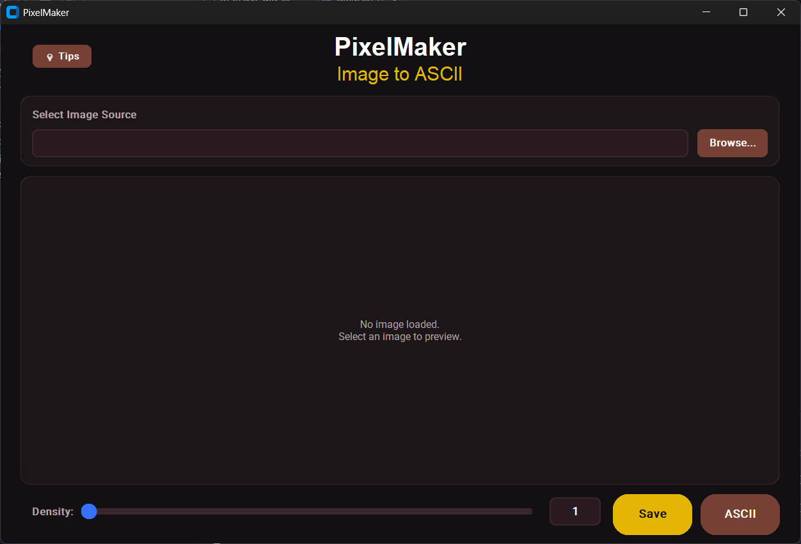
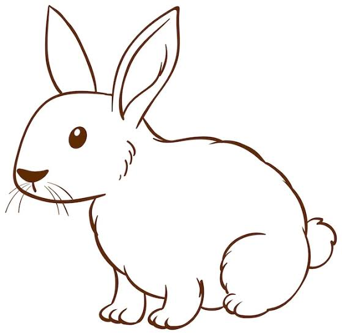

# PixelMaker

-# thanks to [Alpesh](https://github.com/AlpeshMondalCodes)

[](https://www.python.org/downloads/)
[](https://customtkinter.tomschimansky.com/)
[](https://python-pillow.org/)
[](https://github.com/Ankit404butfound/pywhatkit)
[](https://github.com/asweigart/pyperclip)

**PixelMaker** is a desktop application that transforms ordinary images into visual art through two distinct creative modes: **pixelation** and **ASCII conversion**. Built with Python and CustomTkinter, it delivers a modern, intuitive interface that makes professional-grade image transformation accessible to everyone.

> Convert any image into authentic retro pixel art or text-based ASCII artwork — with real-time preview, 6+ handcrafted themes, and zero dependencies on external services.

---

## 📑 Table of Contents

- [Overview](#overview)
- [Features](#features)
- [Screenshots](#screenshots)
- [Manual Installation](#manual-installation)
- [Usage Tips](#usage-tips)
- [Themes](#themes)
- [Technical Details](#technical-details)
- [Project Structure](#project-structure)
- [Performance and Platform Support](#performance-and-platform-support)
---

## Overview

**PixelMaker** is a desktop application that bridges the gap between high-resolution digital imagery and retro artistic expression. It transforms ordinary images into striking visual art through two distinct creative modes: **pixelation** and **ASCII conversion**. Built with Python and CustomTkinter, it delivers a modern, intuitive interface that makes professional-grade image transformation accessible to everyone.

### What It Does

PixelMaker handles the complex processing while you focus on creative control:

- **Pixelation process** — Transform any image into authentic pixel art with adjustable density levels from 1 to 80. The two-stage resampling algorithm (bilinear downscaling + nearest-neighbor upscaling) produces clean, blocky aesthetics that capture the essence of retro gaming art.
- **ASCII Art Generation** — Convert images to ASCII text using high-contrast, symbolic, or simpler images for best results. Best for terminal displays, documentation headers, and text-based projects.
- **Real-Time Preview System** — Watch your transformations happen instantly as you adjust settings. The responsive preview automatically scales to your window size while maintaining aspect ratio, giving you complete visual control over the final output.
- **Professional Theme System** — Work in style with 6+ handcrafted color themes (Nord, Tokyo Night, Dracula, Rose Pine, One Dark, Catppuccin Mocha), each offering both light and dark mode variants to match your workflow preferences.
---

## Features

- **Pixel Art Conversion:** Adjustable density (1–80), live preview, and preservation of the original image.
- **ASCII Art:** Convert images into text-based artwork with `pywhatkit` and copy the result to the clipboard.
- **Responsive Preview:** See changes immediately; the preview adapts to the application window while preserving the image's aspect ratio.
- **Themes:** Six preset themes, with light/dark appearance options and system-theme support.
- **File Support:** Import PNG, JPG/JPEG, BMP, and WebP images; export pixelated images as PNG or JPEG.
- **Density Controls:** Adjust pixelation with a slider or numeric input with validation.

---

## Screenshots

### Main Application
</img>

### Rabbit Image Used for ASCII Conversion
</img>

[Open the generated ASCII text file](screenshots/rabbitASCII.txt)

<details>
<summary>View the generated ASCII output</summary>

```text
...........!:...........................:!......................................
..........:%!%!......................:!**@:.....................................
..........!*.:*%:.................:!**!:.$:.....................................
..........**...!$!..............:!*!!!:..$:.....................................
..........*!....:$!............!*!!*!....$:.....................................
..........%!.....:$!.........:**!%*:..:..%!.....................................
..........%!......:$:.......:%!*%:....!!.$:.....................................
..........**.......!$......:%:*%......*!:$......................................
..........:$........%%.....%!!%......*$.%!......................................
...........%*.......:$:...:%:$:.....!$:**.......................................
...........:$!.......!*...*!*!....:**:*!........................................
............:$*!!!!!!*$!::%:%...:**!:*!.........................................
..........:****!!:::::::!!*!$.:*!:.!*:..........................................
........:**:.............:!!$!*:..**............................................
.......!%!................::&*...%*.............................................
......!%:...................!:..*$*.............................................
.....!%.........:*%$:..........:!.%%:...........................................
....:%:.........&&&S*........::....!$%!:::!!*******!::::........................
....*!..........@##$:........:*!....:!*!!!!::::::!**!**%%*!.....................
...:%............::...........*%........................:!%$*...................
...%!........................!%:...........................:%%!:................
..:$%*!:::!:.................%:..............................:!%%!..............
..:$%#####$:...............:!!..................................:%%:............
...$*!%@%:.::::............::.....................................*@:...........
..:!%$***..!!::!:....::::..........................................:$*..........
..:::!!*%%%*%%**%*%%%$%!:...........................................:$*.........
.::.!.....::!***!::::$...............................................:@!........
.:..:........:.:....!$:...............................................!@::::....
....................:&%................................................@!!$$*:..
.....................%@..................................:!!!:........:@:..:!%!.
......................@:..............................!***!!!:.........%:....!$.
......................*@............................:%*:...............!*....$*.
.......................%$:..........................$*.................:$...:%..
........................*@*........................!%..................:$::!*:..
.........................:$$**.....................%%..................*$*!!....
..........................!$!%*...............::...%:.................:%........
..........................:$..*%!:....::......%$...*$:...............:*:........
..........................*%...:*%%!!:*!......*@....*%:.............!*:.........
.........................:%:.....**!!!@:......!%....%*:::........:!*!...........
.......................!*!!.::...%!:!**.......%%****$%**.....:!***!:............
.......................$*%**%:..!$*%*:.:....:%!.:::..!********!:................
.......................:!**%%****:!$$!$%!!!**:..........::::....................
....................................!*****!:....................................

```

</details>

### Image Guidelines

- Use PNG format with a clean background
- Capture at 100% zoom (1:1 pixels) to avoid blur
- For theme comparisons, use the same sample image in each theme
- Recommended resolution: 1280×720 or higher
- Store in a `screenshots/` directory alongside this README

---


In the meantime, you can preview the application by running `python main.py` after installation.

---

## Manual Installation

### Prerequisites

Before installing PixelMaker, ensure you have the following:

- **Python 3.8 or higher** — Download from [python.org](https://www.python.org/downloads/)
- **pip** package manager (included with Python 3.4+)
- **Git** (optional, for cloning the repository)

To verify your Python installation, run:

```bash
python --version
# or
python3 --version
```

> **Note:** On Windows, make sure Python is added to your system `PATH` during installation so `python` works in the command prompt.

---

### Step 1: Clone or Download the Repository

**Option A: Clone with Git**

```bash
# Clone the repository
git clone https://github.com/AlpeshMondalCodes/PixelMaker.git

# Navigate to the project directory
cd PixelMaker
```

**Option B: Download ZIP**

1. Visit the [PixelMaker repository](https://github.com/AlpeshMondalCodes/PixelMaker)
2. Click the green "Code" button and select "Download ZIP"
3. Extract the ZIP file to your desired location
4. Open a terminal/command prompt and navigate to the extracted folder

```bash
cd path/to/PixelMaker
```

---

### Step 2: Set Up Virtual Environment (Recommended)

Using a virtual environment isolates project dependencies and prevents conflicts with other Python projects.

**On Windows:**

```bash
# Create a virtual environment
python -m venv venv

# Activate the virtual environment
venv\Scripts\activate
```

**On macOS/Linux:**

```bash
# Create a virtual environment
python3 -m venv venv

# Activate the virtual environment
source venv/bin/activate
```

When activated, you should see `(venv)` at the beginning of your terminal prompt.

---

### Step 3: Install Dependencies

With the virtual environment activated, install all required packages:

```bash
pip install -r requirements.txt
```

This will install the following dependencies:

| Package | Version | Purpose |
|---------|---------|---------|
| `customtkinter` | >= 5.2.0 | Modern, themeable GUI framework built on tkinter |
| `Pillow` | >= 10.0.0 | Image processing library (loading, resizing, saving) |
| `pywhatkit` | >= 1.0.0 | ASCII art conversion functionality |
| `pyperclip` | >= 1.8.2 | Clipboard operations for copying ASCII art |

**Note:** If you encounter any SSL certificate errors during installation, try:

```bash
pip install --trusted-host pypi.org --trusted-host files.pythonhosted.org -r requirements.txt
```

---

### Step 4: Run the Application

Once all dependencies are installed, launch PixelMaker:

```bash
python main.py
```

The PixelMaker window should open immediately, ready for use!

---

### Troubleshooting

**Issue: `python` command not found**
- Try using `python3` instead of `python`
- Ensure Python is added to your system PATH during installation

**Issue: Permission denied on macOS/Linux**
- Use `python3 -m pip install -r requirements.txt` instead

**Issue: Module import errors**
- Ensure your virtual environment is activated
- Re-run `pip install -r requirements.txt`

**Issue: tkinter not found (On Linux)**
- On Ubuntu/Debian: `sudo apt-get install python3-tk`
- On Fedora: `sudo dnf install python3-tkinter`


---
## Usage Tips
#### Best Image Selection

**High-Contrast Images** work best for ASCII:
- Photographs with distinct light and shadow areas
- Logo or icon designs with solid colors
- Symbolic images with clear subjects

**Images to Avoid for ASCII**:
- Gradients or smooth color transitions (unclear ASCII output)
- Very small images (less than 200×200 pixels)
- Extremely detailed or noisy images

**For Pixel Art:**
- Any image works, but stylized images (animations, digital art) often yield the best aesthetic results
- Photos can look nostalgic with pixel art treatment

#### Optimizing for ASCII Quality

**Prepare the Image**
   - Ensure good contrast (not too washed out)
   - Remove unnecessary blur or noise
   - Crop to focus on the main subject

#### Troubleshooting ASCII Output

| Issue | Cause | Solution |
|-------|-------|----------|
| ASCII looks distorted | Non-monospace font used | Switch to Courier New, Consolas, or Monaco |
| Output is too sparse | Image is too light or low contrast | Increase image contrast or density |
| Output is too dense | Image is too dark or density too high | Reduce density or lighten the image |
| Characters misaligned | Line wrapping enabled | Disable word wrap in your editor/viewer |
| Slow generation | First-time use or very large image | Wait for module loading; works faster on repeat use |

> troubleshooting techniques generated by AI maybe misleading.

---

## Themes

PixelMaker includes **6 professionally designed themes**, each with light and dark mode variants. Every theme has been carefully crafted with optimized color palettes for readability, aesthetics, and visual comfort during extended use.

### Available Theme Presets

| Theme | File | Aesthetic | Dark Base | Key Accents | Screenshots |
|-------|------|-----------|-----------|-------------|-------------|
| **Default** | `theme.py` (active) | Auburn-tinted dark, sophisticated | `#121013` | Electric Blue `#3772FF`, Amber Gold `#E3B505` | [Main app](screenshots/mainWindow.png) |
| **Nord** | `nord_theme.py` | Arctic, north-bluish, calm | `#2e3440` | Frost Ice Blue `#88c0d0`, Aurora Green `#a3be8c` | [Dark](screenshots/nordDark.png) · [Light](screenshots/nordLight.png) |
| **Tokyo Night** | `tokyo_night_theme.py` | Neon-lit city, vibrant | `#1a1b26` | Neon Blue `#7aa2f7`, Neon Purple `#bb9af7` | [Dark](screenshots/tokyo-nightDark.png) · [Light](screenshots/tokyo-nightLight.png) |
| **Dracula** | `dracula_theme.py` | High-contrast purple, dramatic | `#282a36` | Purple `#bd93f9`, Pink `#ff79c6`, Green `#50fa7b` | [Dark](screenshots/draculaDark.png) · [Light](screenshots/draculaLight.png) |
| **Rose Pine** | `rose_pine_theme.py` | Elegant, low-contrast, eye-friendly | — | Soft rose and pine-inspired muted tones | [Dark](screenshots/rose-pineDark.png) · [Light](screenshots/rose-pineLight.png) |
| **One Dark** | `one_dark_theme.py` | Balanced, Atom editor classic | — | Warm accents optimized for long sessions | [Dark](screenshots/one_dark-Dark.png) · [Light](screenshots/one_dark-Light.png) |
| **Catppuccin Mocha** | `catppuccin_mocha.py` | Warm pastels, soothing | `#1e1e2e` | Lavender `#b4befe`, Pink `#f5c2e7` | [Dark](screenshots/catppuccinMochaDark.png) · [Light](screenshots/CatppuccinLight.png) |

> **Light mode** is available for every theme. The Default, Nord, Tokyo Night, Dracula, and Catppuccin Mocha themes ship with fully defined light palettes.

### How to Change Themes

Switching themes is simple and requires no code modifications beyond file replacement.

#### Method 1: File Replacement (Recommended)

1. **Navigate to the `themes/` directory** in your PixelMaker installation
2. **Choose your preferred theme file**:
   - `nord_theme.py` - Nord arctic theme
   - `tokyo_night_theme.py` - Tokyo Night neon theme
   - `dracula_theme.py` - Dracula high-contrast theme
   - `rose_pine_theme.py` - Rose Pine elegant theme
   - `one_dark_theme.py` - One Dark balanced theme
   - `catppuccin_mocha.py` - Catppuccin warm pastels
3. **Copy the theme file to the root directory** and rename it to `theme.py`:

```bash
# Example: Switch to Nord theme
cp themes/nord_theme.py theme.py

# Or on Windows Command Prompt:
copy themes\nord_theme.py theme.py

# Or on Windows PowerShell:
Copy-Item themes\nord_theme.py theme.py
```

4. **Restart PixelMaker** to apply the new theme

The application will immediately load with your selected color scheme applied to all UI elements.

### Theme File Structure

Every theme file contains a `COLORS` dictionary with separate palettes for dark and light modes, plus a `get_color()` function:

```python
"""
Custom Theme definitions for PixelMaker application.
"""

COLORS = {
    "dark": {
        "bg_main": "#121013",           # Main application background
        "bg_card": "#1D1619",           # Card & container background
        "bg_inset": "#2A1A1F",          # Input fields, textbox backgrounds
        "text_primary": "#FFFFFF",      # High contrast primary text
        "text_secondary": "#B3A5A8",    # Labels, muted secondary text
        "accent_primary": "#3772FF",    # Primary buttons (Browse, Slider)
        "accent_primary_hover": "#2557D6",  # Primary button hover state
        "accent_secondary": "#E3B505",  # Secondary buttons (Save)
        "accent_secondary_hover": "#C69E00",  # Secondary button hover
        "accent_muted": "#764134",      # Utility buttons (Tips, ASCII, Copy)
        "accent_muted_hover": "#8C4E3F",  # Utility button hover
        "border": "#3A262C",            # Card borders, input borders
    },
    "light": {
        "bg_main": "#F0F3F9",           # Main application background
        "bg_card": "#FFFFFF",           # Card & container background
        "bg_inset": "#E5EAF3",          # Input fields, textbox backgrounds
        "text_primary": "#1E293B",      # High contrast primary text
        "text_secondary": "#64748B",    # Labels, muted secondary text
        "accent_primary": "#2563EB",    # Primary buttons
        "accent_primary_hover": "#1D4ED8",
        "accent_secondary": "#059669",  # Secondary buttons
        "accent_secondary_hover": "#047857",
        "accent_muted": "#475569",      # Utility buttons
        "accent_muted_hover": "#334155",
        "border": "#CBD5E1",            # Borders
    }
}

def get_color(color_key: str):
    """
    Returns a tuple of (light_color, dark_color) suitable for CustomTkinter
    color arguments.
    """
    return (COLORS["light"][color_key], COLORS["dark"][color_key])
```

#### Color Key Reference

| Key | UI Element | Usage |
|-----|------------|-------|
| `bg_main` | Main window background | Overall application backdrop |
| `bg_card` | Card containers | File selector card, preview card frames |
| `bg_inset` | Input elements | Entry fields, textboxes, inset fields |
| `text_primary` | Primary text | Titles, main content, high-contrast text |
| `text_secondary` | Secondary text | Labels, subtitles, descriptive text |
| `accent_primary` | Primary actions | Browse button, slider, main interactive elements |
| `accent_primary_hover` | Primary hover | Hover state for primary buttons |
| `accent_secondary` | Secondary actions | Save button, important secondary actions |
| `accent_secondary_hover` | Secondary hover | Hover state for secondary buttons |
| `accent_muted` | Utility actions | Tips, ASCII, Copy buttons |
| `accent_muted_hover` | Utility hover | Hover state for utility buttons |
| `border` | Borders & dividers | Card borders, input borders |

#### Creating a Custom Theme

**Modify the color codes in the theme.py** - just as simple as pasting colors

#### Example: Custom Ocean Theme

```python
COLORS = {
    "dark": {
        "bg_main": "#0a1929",           # Deep ocean blue
        "bg_card": "#0d2136",
        "bg_inset": "#1a3a52",
        "text_primary": "#e3f2fd",
        "text_secondary": "#90caf9",
        "accent_primary": "#00bcd4",    # Cyan
        "accent_primary_hover": "#0097a7",
        "accent_secondary": "#4dd0e1",  # Light cyan
        "accent_secondary_hover": "#26c6da",
        "accent_muted": "#37474f",
        "accent_muted_hover": "#455a64",
        "border": "#1e3a5f",
    },
    "light": {
        "bg_main": "#e1f5fe",           # Light sky blue
        "bg_card": "#ffffff",
        "bg_inset": "#b3e5fc",
        "text_primary": "#01579b",
        "text_secondary": "#0277bd",
        "accent_primary": "#0288d1",
        "accent_primary_hover": "#01579b",
        "accent_secondary": "#00acc1",
        "accent_secondary_hover": "#00838f",
        "accent_muted": "#546e7a",
        "accent_muted_hover": "#37474f",
        "border": "#81d4fa",
    }
}

def get_color(color_key: str):
    return (COLORS["light"][color_key], COLORS["dark"][color_key])
```

### Theme Mode Configuration

Control whether PixelMaker uses light mode, dark mode, or automatically follows your system theme by editing the `app.json` configuration file.

#### Configuration Options

Edit `app.json` in the root directory:

```json
{
  "theme": "System",
  "appHeight": 650,
  "appWidth": 1000
}
```

**Available `theme` values:**
- `"System"` - Automatically matches your operating system's light/dark mode setting (default)
- `"Dark"` - Always use dark mode regardless of system settings
- `"Light"` - Always use light mode regardless of system settings

#### Example Configurations

**Always use Dark Mode:**
```json
{
  "theme": "Dark",
  "appHeight": 650,
  "appWidth": 1000
}
```

**Always use Light Mode:**
```json
{
  "theme": "Light",
  "appHeight": 650,
  "appWidth": 1000
}
```

**Custom Window Size with System Theme:**
```json
{
  "theme": "System",
  "appHeight": 880,
  "appWidth": 1200
}
```

---

## Technical Details

### Pixelation Algorithm

PixelMaker implements a sophisticated two-stage resampling process that creates authentic pixel art while preserving image integrity.

#### Stage 1: Downscaling with BILINEAR Interpolation

The original image is first reduced to a fraction of its original size using **BILINEAR** resampling. This smooths the image and averages pixel values across the reduced resolution:

```python
# Calculate reduced dimensions based on pixel density
small_width = max(1, original_width // pixel_density)
small_height = max(1, original_height // pixel_density)

# Downscale with bilinear interpolation
img_small = current_pil_image.resize(
    (small_width, small_height),
    resample=Image.Resampling.BILINEAR
)
```

#### Stage 2: Upscaling with NEAREST Neighbor

The downscaled image is then enlarged back to the original dimensions using **NEAREST** neighbor resampling. This creates the characteristic blocky, pixelated effect by replicating each small pixel into a larger square block:

```python
# Upscale back to original size with nearest neighbor
processed_pil_image = img_small.resize(
    (original_width, original_height),
    resample=Image.Resampling.NEAREST
)
```

#### Why This Approach?

- **BILINEAR downscaling** prevents aliasing artifacts and creates smoother color transitions in the reduced image
- **NEAREST upscaling** preserves sharp pixel boundaries, creating clean, uniform blocks without blur
- This combination produces pixel art that looks intentional and aesthetic, not merely low-resolution
- The algorithm maintains the original image dimensions, making it easy to compare before/after results

#### Density Control (1-80 Range)

| Density | Effect |
|---------|--------|
| 1 | Original image (no pixelation) |
| 10-20 | Subtle pixelation, recognizable details |
| 30-50 | Strong retro game aesthetic |
| 60-80 | Extreme abstraction, mosaic-like effects |

---

### ASCII Conversion Process

PixelMaker uses the **pywhatkit** library for ASCII art generation, which maps image brightness values to ASCII characters with varying visual density.

#### Best Practices

- Use **high-contrast images** (logos, silhouettes, simple graphics) for best ASCII results
- Prefer **square or portrait-oriented images** over wide landscapes
- Dark backgrounds work better than complex, multi-toned photographs

---

### Dependencies Explained

| Package | Version | Purpose | Why We Use It |
|---------|---------|---------|---------------|
| `customtkinter` | >= 5.2.0 | Modern GUI framework | Built on top of tkinter with a contemporary, polished appearance; native light/dark mode theming; rounded corners, smooth animations, and modern widgets; cross-platform compatibility |
| `Pillow` | >= 10.0.0 | Image processing library | Industry-standard PIL fork; comprehensive format support (PNG, JPG, BMP, WebP); advanced resampling algorithms (BILINEAR, NEAREST, LANCZOS); efficient in-memory image manipulation |
| `pywhatkit` | >= 1.0.0 | ASCII art conversion | Built-in image-to-ASCII conversion functionality; handles character mapping and brightness analysis automatically; no need to implement custom ASCII conversion logic |
| `pyperclip` | >= 1.8.2 | Clipboard operations | Simple API for copying text to system clipboard; works consistently across Windows, macOS, and Linux; handles large text blocks (ASCII art) efficiently |

---

### Configuration Files

PixelMaker uses two primary configuration files for customization:

#### app.json - Application Settings

**Location**: Root directory  
**Format**: JSON  
**Purpose**: Stores user preferences and window settings

```json
{
  "theme": "System",       // Appearance mode
  "appHeight": 650,        // Initial window height (pixels)
  "appWidth": 1000         // Initial window width (pixels)
}
```

| Key | Type | Options | Description |
|-----|------|---------|-------------|
| `theme` | String | `"System"`, `"Light"`, `"Dark"` | Appearance mode (System follows OS preference) |
| `appWidth` | Integer | 720-1920 (recommended) | Default window width in pixels |
| `appHeight` | Integer | 650-1080 (recommended) | Default window height in pixels |

**Notes**:
- Changes take effect on next application restart
- Minimum window size is enforced (900×650) regardless of settings
- Invalid values fall back to defaults (1000×650, System theme)

#### theme.py - Color Definitions

**Location**: Root directory  
**Format**: Python module  
**Purpose**: Defines the active color palette for both light and dark modes

See the [Themes](#themes) section for the full structure, color key reference, and customization guide.

---

## Project Structure

```
PixelMaker/
│
├── main.py                          # Main application entry point (480 lines)
│   ├── GUI initialization and layout
│   ├── Event handlers and callbacks
│   ├── Image processing functions
│   ├── File operations (browse, save)
│   └── ASCII conversion logic
│
├── theme.py                         # Active theme configuration (40 lines)
│   ├── COLORS dictionary (dark/light palettes)
│   └── get_color() helper function
│
├── app.json                         # Application configuration (5 lines)
│   ├── "theme": Appearance mode ("System", "Light", "Dark")
│   ├── "appWidth": Default window width in pixels
│   └── "appHeight": Default window height in pixels
│
├── requirements.txt                 # Python dependencies (4 packages)
│   ├── customtkinter>=5.2.0
│   ├── Pillow>=10.0.0
│   ├── pywhatkit>=1.0.0
│   └── pyperclip>=1.8.2
│
├── README.md                        # Complete documentation
│
└── themes/                          # Theme presets directory
    ├── nord_theme.py                # Arctic, north-bluish palette
    ├── tokyo_night_theme.py         # Neon Tokyo night theme
    ├── dracula_theme.py             # High-contrast purple-tinted dark
    ├── rose_pine_theme.py           # Elegant, low-contrast scheme
    ├── one_dark_theme.py            # Popular Atom editor theme
    └── catppuccin_mocha.py          # Warm, pastel-inspired palette
```

#### File Responsibilities

- **`main.py`**: Core application logic, GUI construction, event handling, image processing, ASCII conversion
- **`theme.py`**: Color definitions for the active theme, referenced throughout the UI via `get_color()`
- **`app.json`**: User-configurable settings loaded at startup (appearance mode, window dimensions)
- **`themes/`**: Swappable theme presets; copy any to `theme.py` to activate

---

## Performance and Platform Support


### Platform Support

| Platform | Status | Requirements |
|----------|--------|--------------|
| Windows | Fully supported (tested on Windows 10/11) | Standard Python + tkinter install |
| macOS | Compatible | Requires Python 3.8+ |
| Linux | Compatible | May require additional tkinter system package |

**Linux setup:**
```bash
sudo apt-get install python3-tk   # Ubuntu/Debian
sudo dnf install python3-tkinter   # Fedora
```
---
